**Nikolas de Hor** · AI Engineer · agents & MCP in production · [dehor.dev](https://dehor.dev)

### Things I built

&nbsp;
&nbsp;
&nbsp;

Cards generated by <code>scripts/build-svgs.mjs</code>, pixel art from <a href="https://dehor.dev">dehor.dev</a>.
